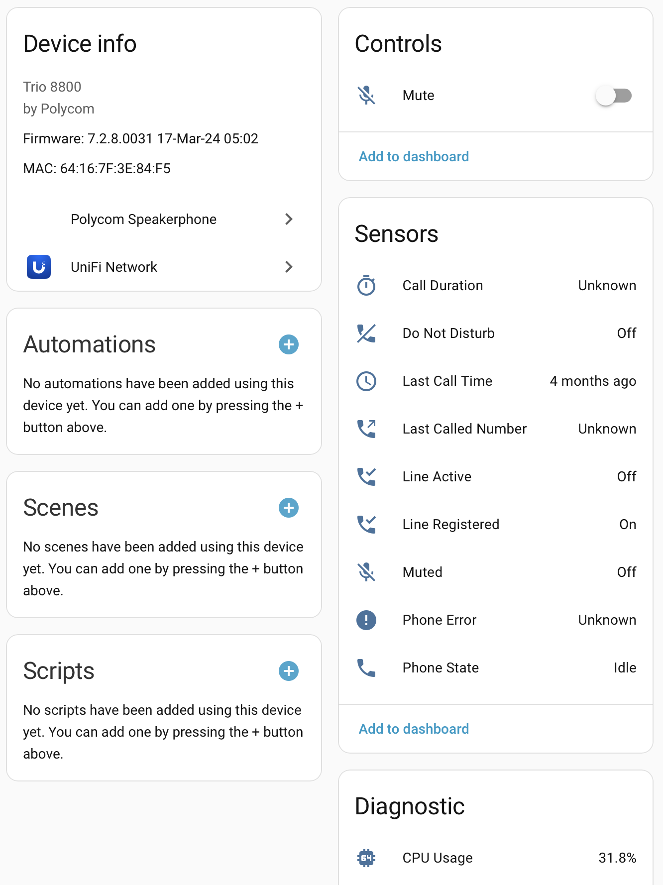

# Polycom Speakerphone Integration for Home Assistant

A custom Home Assistant integration for monitoring and [kind of] controlling Polycom Trio 8800 speakerphones via their local REST API.

### Device Compatibility

Polycom's devices seem to sporadically support their API. I only have a Trio 8800 to test with, but it supports only some of the features defined in [their API](https://kaas.hpcloud.hp.com/pdf-public/pdf_14672705_en-US-1.pdf). This component could/should support more models, but it would need to be a model-by-model testing. 

#### Aside/Motivation
_Not that you asked, but they are remarkably cheap (about $30 used), have a pretty great/modern industrial design, and they play nice with Unifi Talk (including supporting paging/auto-answer), so they make really nice devices for a home intercom system that is built around Unifi Talk. I wanted to be able to make sure the ones I have throughout my house are still online, and have a tiny bit of control over them (albeit a little bit limited due to their slightly older firmware)._

_Anyway..._

## Features

The component provides entities to monitor the speakerphone, and actions to place and handle calls.

### Entities

| Entity | Possible Values | Notes |
|--------|-----------------|-------|
| `sensor.<device_name>_phone_state` | Idle, Active, Error | Current phone status from pollForStatus |
| `sensor.<device_name>_last_call_time` | Timestamp | When the last call occurred |
| `sensor.<device_name>_call_duration` | Seconds | How long the current call has lasted |
| `sensor.<device_name>_remote_party` | Name or number | Who's on the current call |
| `sensor.<device_name>_phone_error` | Text or None | The phone's error message, if it reports one |
| `sensor.<device_name>_last_called_number` | Phone number | Last dialed number |
| `sensor.<device_name>_missed_calls` | Number | Calls in the phone's missed call log |
| `binary_sensor.<device_name>_ringing` | On/Off | A call is ringing |
| `binary_sensor.<device_name>_do_not_disturb` | On/Off | DND status |
| `binary_sensor.<device_name>_muted` | On/Off | Microphone mute status |
| `binary_sensor.<device_name>_line_registered` | On/Off | SIP line registration status |
| `binary_sensor.<device_name>_line_active` | On/Off | Line active status |
| `switch.<device_name>_mute` | On/Off | Control microphone mute |
| `sensor.<device_name>_cpu_usage` | 0-100% | Processor utilization (Diagnostic) |
| `sensor.<device_name>_memory_usage` | 0-100% | Memory utilization (Diagnostic) |
| `sensor.<device_name>_memory_total` | MiB | Total memory available (Diagnostic) |
| `sensor.<device_name>_sip_connection` | Connected, Disconnected, Unknown | SIP server connection status (Diagnostic) |
| `sensor.<device_name>_uptime` | Timestamp | When the device was last started (Diagnostic) |
| `button.<device_name>_reboot` | - | Reboot the device (Diagnostic) |

The ringing, remote party and missed calls entities are only created if the phone answers the API endpoints they need when the integration starts.

### Actions

Every action targets one or more speakerphone devices, or an area to act on the speakerphones in it. With a single speakerphone the target can be left out.

- **`poly.dial`**: Call an extension, phone number or SIP address. Takes `number` and an optional `line` (defaults to line 1).
- **`poly.answer_call`**: Answer the incoming call.
- **`poly.reject_call`**: Reject the incoming call.
- **`poly.end_call`**: Hang up the current call.
- **`poly.reboot`**: Safely (after calls have completed) reboot a speakerphone. The **Reboot** button entity does the same thing.

For example, to call the kitchen from the office speakerphone when a button is pressed:

```yaml
action: poly.dial
target:
  device_id: <pick the office speakerphone in the action editor>
data:
  number: "1002"
```

Automations written for 0.2.0 that choose the speakerphone with `config_entry_id` keep working.

## Screenshot



## Installation

### HACS (Recommended)
1. Open HACS in Home Assistant
2. Go to "Integrations"
3. Click the three dots in the top right corner
4. Select "Custom repositories"
5. Add this repository URL: `https://github.com/zacs/ha-polycom_speakerphone`
6. Select category "Integration"
7. Click "Add"
8. Install the integration
9. Restart Home Assistant

### Manual Installation
1. Copy the `custom_components/poly` directory to your Home Assistant's `custom_components` directory
2. Restart Home Assistant

## Speakerphone Setup

You need to enable the REST API on the Trio. 

1. Head to https://<trio_ip> and login as admin. 
   - If you bought a used device, you may need to factory reset to set your own admin password.
2. Go to _Settings > Applications_ in the menu bar. 
3. Expand the "REST API" section in the main content area.
4. Tick the box to enable the REST API. 
5. Press "Save."

## Configuration

1. Go to **Settings** > **Devices & Services**
2. Click **Add Integration**
3. Search for **Polycom Speakerphone**
4. Enter the required information:
   - **IP address**: The IP address of your Polycom Trio 8800
   - **Password**: The device password
   - **Verify SSL certificate**: Typically set to false for local devices with self-signed certificates
5. Click **Submit**

The integration will automatically discover the device and create all sensors.

### Changing the IP address or password

- **New IP address**: on the integration's entry in **Settings** > **Devices & Services**, open the menu and choose **Reconfigure**. Re-adding the same phone at its new address also updates the existing entry.
- **New password**: Home Assistant notices the phone rejecting the old password and asks you to re-authenticate.

## Removal

1. Go to **Settings** > **Devices & Services** and select **Polycom Speakerphone**.
2. Open the menu on each speakerphone's entry and choose **Delete**.
3. If you no longer want the integration, remove it in HACS (or delete `custom_components/poly`) and restart Home Assistant.

## Requirements

- Home Assistant 2025.2.4 or newer
- Polycom Trio 8800 speakerphone
- REST API enabled on the Polycom device (not enabled by default)

## API Documentation

This integration uses the Polycom Voice REST API. For more information, see:
- [Poly UC Software and Poly Voice Software REST API Reference Manual (PDF)](https://kaas.hpcloud.hp.com/pdf-public/pdf_14672705_en-US-1.pdf)

## Troubleshooting

### HACS can't find `custom_components/polycom_speakerphone/manifest.json`

Before 0.2.0 the integration's folder in this repository was named `polycom_speakerphone`; it's now `poly`. HACS remembers the old folder until Home Assistant restarts, so updating from 0.1.x can fail with `No manifest.json file found 'custom_components/polycom_speakerphone/manifest.json'`. Restart Home Assistant and download the update again. If it still fails, remove the repository in HACS, add it again and download it; your speakerphones' settings and entities are kept.

### Connection Issues
- Confirm connectivity and credentials by visiting `https://<YOUR_IP>/api/v2/mgmt/device/info` with username `Polycom` and your admin password. You should see a JSON blob of device details. 
- Ensure the device IP address is correct 
- Verify network connectivity between Home Assistant and the device (ping the device IP from Home Assistant's host)
- Try disabling SSL verification during setup
- Check that the REST API is enabled on the Polycom device

### Missing Sensors

Some sensors may not appear if the corresponding API endpoints are not available on your device firmware version.

## Contributing

Contributions are welcome! Please feel free to submit a Pull Request.

## License

This project is licensed under the MIT License - see the [LICENSE](LICENSE) file for details.

## Disclaimer

This is an unofficial integration and is not affiliated with or endorsed by Poly (formerly Polycom).
